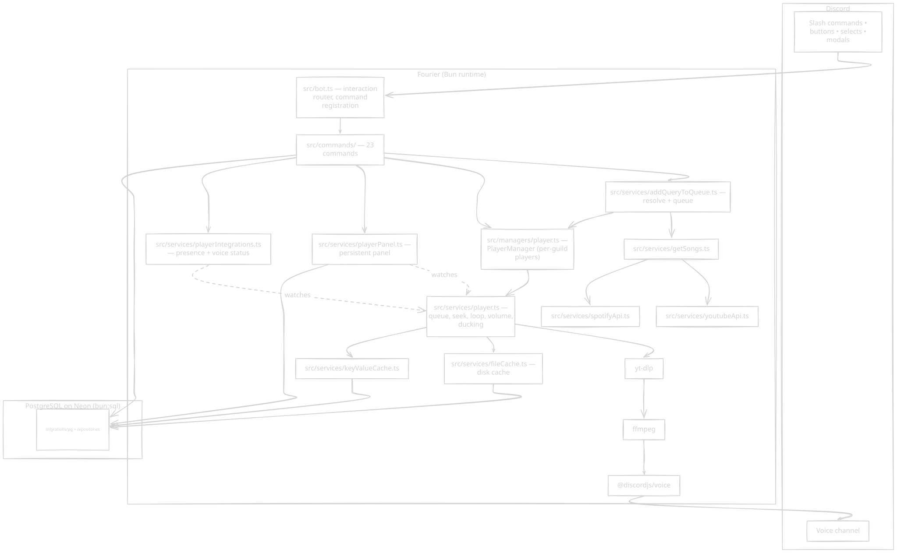
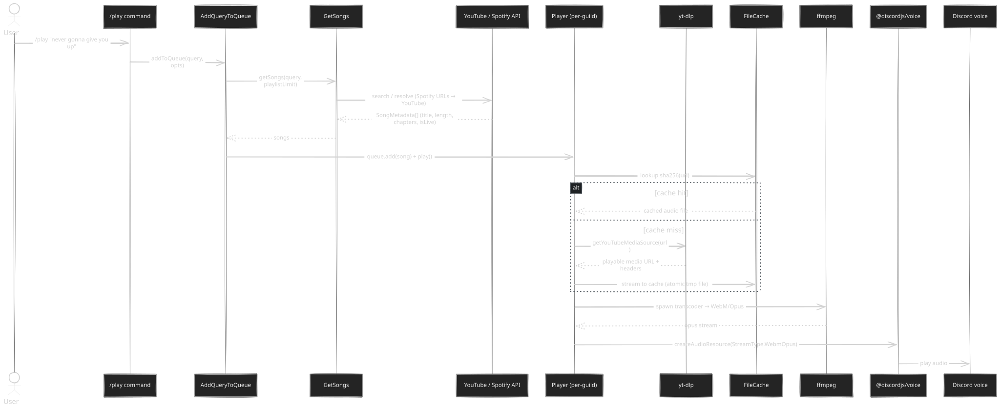

<p align="center">
  
</p>

<h1 align="center">Fourier</h1>

<p align="center"><b>A self-hosted Discord music bot you run on your own hardware.</b></p>

<p align="center">
  <a href="https://bun.sh"></a>
  <a href="#development"></a>
  <a href="https://discord.js.org"></a>
  <a href="#development"></a>
  <a href="#development"></a>
  <a href="LICENSE"></a>
</p>

---

## What is Fourier?

Fourier is a Discord music bot that runs as a single [Bun](https://bun.sh) process on a machine you
control. It streams audio into voice channels through `yt-dlp` → `ffmpeg` → `@discordjs/voice`, and
stores settings, favorites, player panels, and caches in a [Neon PostgreSQL](https://neon.tech)
database that belongs to you.

No hosted service, no subscription, no analytics, and no third-party dashboard. Clone it, add your
credentials, start it.

## See it in action

<p align="center">
  
</p>

## A slightly evil music bot

Fourier is not a well-behaved bot. It does not open votes, it does not ask twice, and it does not
care who queued the song before you. It plays what it is told, at the volume it is told, until the
queue runs out — then it leaves without a goodbye.

That is the design: one queue, one authority, no negotiation. It sounds harsh, and it is. It is also
why the music does not stop because six people could not agree on a skip.

It is still polite where it matters. It asks for the minimum voice permissions, it never reads your
messages, and it keeps your listening data on your own database. Think of it as a villain with good
manners.

## Features

**Playback**

- YouTube videos, playlists, and livestreams, including direct and `.m3u8` URLs
- Optional Spotify track, album, playlist, and artist URL conversion
- Search suggestions on `/play`, with recent tracks shown first when the field is empty
- Absolute and relative seeking (`/seek`, `/fseek`; `1m 30s` is accepted)
- YouTube chapters as individual queue entries (opt-in with `/play split:*`)
- Track and queue looping, `/replay`, `/unskip`, volume from 0 to 100
- Automatic ducking: music lowers while people speak
- Optional SponsorBlock skipping for intros and ads
- Retries, voice-connection recovery, and unplayable tracks skipped instead of stalling the player

**Queue and library**

- Paginated `/queue`, plus `/clear` (with confirmation), `/remove`, `/move`, and `/shuffle`
- Named favorites: `/favorites create`, `use`, `list`, and `remove`
- Content-hash audio cache on disk, bounded by `CACHE_LIMIT` (default 2 GB)
- Persistent player panel (`/setup panel`) with pause, skip, stop, shuffle, loop, volume, and search
- Voice channel status showing the current track, where permissions allow
- Automatic leave: 30 seconds after the queue empties, or when everyone else has left
- Multiple guilds with isolated queues, settings, and panels
- Per-guild option to show queue confirmations only to the requester

## Requirements

- 64-bit Linux, macOS, or Windows
- [Bun](https://bun.sh) **≥ 1.4.0** (the lockfile pins `bun@1.4.0`)
- **ffmpeg ≥ 4.1** on `PATH`
- **yt-dlp** at `<project root>/bin/yt-dlp`, on `PATH`, or via `YT_DLP_PATH`
- A **Neon PostgreSQL** project with a direct, non-pooled connection URL
- A Discord bot token and a YouTube Data API v3 key

Fourier runs as one Bun process. yt-dlp handles YouTube extraction and uses a JavaScript runtime
(`--js-runtimes node`) for YouTube's JS challenges, so keep it current; `YT_DLP_AUTO_UPDATE=true`
does that at startup.

## Quick start

### 1. Credentials

| Variable                                      | Where to get it                                                                                                 | Required |
| --------------------------------------------- | --------------------------------------------------------------------------------------------------------------- | -------- |
| `DISCORD_TOKEN`                               | [Discord Developer Portal](https://discordapp.com/developers/applications) → **Bot** → **Reset Token**          | Yes      |
| `YOUTUBE_API_KEY`                             | [Google Developer Console](https://console.developers.google.com) → enable _YouTube Data API v3_ → create a key | Yes      |
| `DATABASE_URL`                                | A [Neon](https://neon.tech) project → the direct, non-pooled connection string                                  | Yes      |
| `SPOTIFY_CLIENT_ID` / `SPOTIFY_CLIENT_SECRET` | [Spotify Developer Dashboard](https://developer.spotify.com/dashboard/applications)                             | Optional |

### 2. Install and run

```bash
git clone https://github.com/PhotoDotPi/Fourier.git && cd Fourier
cp .env.example .env      # then fill in your values
bun install
```

If `yt-dlp` is not on `PATH`, put a binary in `bin/`:

```bash
mkdir -p bin
curl -L -o bin/yt-dlp https://github.com/yt-dlp/yt-dlp/releases/latest/download/yt-dlp
chmod +x bin/yt-dlp
```

Start the bot. Database migrations run automatically before it connects:

```bash
bun start
```

Fourier logs an invite URL at startup. Open it to add the bot; the server owner receives a short
welcome message. For local experiments, `bun run dev` runs with `--watch` and skips migrations.

## Discord setup

Create an [application](https://discordapp.com/developers/applications), add a bot user, and copy
its token into `DISCORD_TOKEN`.

- **Intents:** `Guilds`, `GuildMessageReactions`, and `GuildVoiceStates`. None are privileged.
- **Permissions:** the invite requests **Connect**, **Speak**, and **Use Voice Activity** only.
  There is no Administrator, no message-content access, and no channel management. Optional
  features such as the voice channel status line quietly do nothing without extra permissions.
- **Command registration:** per-guild by default, which updates immediately. If you run the bot in
  10 or more guilds, set `REGISTER_COMMANDS_ON_BOT=true` to register globally; changes can take up
  to an hour to propagate.

## Configuration

All configuration is read from environment variables, loaded from `.env` at startup. See
`.env.example` for a template.

| Variable                                      | Required | Default             | Description                                          |
| --------------------------------------------- | -------- | ------------------- | ---------------------------------------------------- |
| `DISCORD_TOKEN`                               | Yes      | –                   | Discord bot token                                    |
| `YOUTUBE_API_KEY`                             | Yes      | –                   | YouTube Data API v3 key                              |
| `DATABASE_URL`                                | Yes      | –                   | Direct, non-pooled Neon connection string            |
| `SPOTIFY_CLIENT_ID` / `SPOTIFY_CLIENT_SECRET` | No       | –                   | Enables Spotify URLs and suggestions                 |
| `DATA_DIR`                                    | No       | `./data`            | Audio cache and temporary files                      |
| `CACHE_LIMIT`                                 | No       | `2GB`               | Disk budget for the audio cache (`512MB`, `10GB`, …) |
| `ENABLE_SPONSORBLOCK`                         | No       | `false`             | Skip SponsorBlock-tagged segments                    |
| `SPONSORBLOCK_TIMEOUT`                        | No       | `5`                 | Minutes to back off when the API is unreachable      |
| `YT_DLP_PATH`                                 | No       | `<root>/bin/yt-dlp` | Explicit yt-dlp executable path                      |
| `YT_DLP_AUTO_UPDATE`                          | No       | `false`             | Update yt-dlp before connecting                      |
| `YT_DLP_COOKIES_PATH`                         | No       | –                   | Netscape cookies file for age-restricted videos      |
| `REGISTER_COMMANDS_ON_BOT`                    | No       | `false`             | Register slash commands globally                     |
| `BOT_STATUS`                                  | No       | `online`            | `online`, `idle`, or `dnd`                           |
| `BOT_ACTIVITY_TYPE`                           | No       | `LISTENING`         | `PLAYING`, `LISTENING`, `WATCHING`, or `STREAMING`   |
| `BOT_ACTIVITY`                                | No       | `music`             | Activity text shown after the type                   |
| `BOT_ACTIVITY_URL`                            | No       | –                   | Required when `BOT_ACTIVITY_TYPE=STREAMING`          |
| `ENV_FILE`                                    | No       | `./.env`            | Alternate environment file                           |

**Age-restricted videos:** point `YT_DLP_COOKIES_PATH` at a YouTube-only Netscape cookie file
exported from an age-verified account (see the
[yt-dlp guide](https://github.com/yt-dlp/yt-dlp/wiki/Extractors#exporting-youtube-cookies)). Treat
the file like a password; Fourier copies it to a private per-extraction temp file. Without cookies,
Fourier makes one best-effort search for a matching audio-only upload.

## Commands

All 23 slash commands. Most actions also have a button equivalent.

**Playback**

| Command                                              | What it does                                                                                                      |
| ---------------------------------------------------- | ----------------------------------------------------------------------------------------------------------------- |
| `/play <query> [immediate] [shuffle] [split] [skip]` | Play a song, playlist, livestream, or search. `immediate` puts it at the front, `split` treats chapters as tracks |
| `/pause` · `/resume`                                 | Pause or resume                                                                                                   |
| `/skip [number]` · `/next` · `/unskip`               | Skip ahead, skip one, or go back                                                                                  |
| `/replay`                                            | Restart the current track                                                                                         |
| `/stop` · `/disconnect`                              | Stop and clear the queue, or pause and leave                                                                      |
| `/loop` · `/loop-queue`                              | Loop the track or the queue                                                                                       |
| `/shuffle`                                           | Shuffle the queue                                                                                                 |
| `/seek <time>` · `/fseek <time>`                     | Seek to an absolute or relative time (`1m30s`, `100`)                                                             |
| `/volume <level>`                                    | Set volume from 0 to 100                                                                                          |

**Queue and history**

| Command                      | What it does                                                     |
| ---------------------------- | ---------------------------------------------------------------- |
| `/queue [page] [page-size]`  | Paginated queue (10 per page by default, 30 max)                 |
| `/now-playing`               | Show the current track                                           |
| `/clear`                     | Clear queued tracks and keep the current one (with confirmation) |
| `/remove <position> [range]` | Remove one track or a range                                      |
| `/move <from> <to>`          | Reorder the queue                                                |

**Favorites**

| Command                                                      | What it does                        |
| ------------------------------------------------------------ | ----------------------------------- |
| `/favorites create <name> <query>`                           | Save any `/play` query under a name |
| `/favorites use <name> [immediate] [shuffle] [split] [skip]` | Queue a favorite                    |
| `/favorites list` · `/favorites remove <name>`               | List or delete favorites            |

**Configuration and setup**

| Command                                     | What it does                                                  |
| ------------------------------------------- | ------------------------------------------------------------- |
| `/config get`                               | Show all per-guild settings                                   |
| `/config set-playlist-limit`                | Maximum tracks from one playlist (default 50)                 |
| `/config set-wait-after-queue-empties`      | Seconds to stay after the queue empties (0 means never leave) |
| `/config set-leave-if-no-listeners`         | Leave when everyone else leaves                               |
| `/config set-queue-add-response-hidden`     | Show queue confirmations only to the requester                |
| `/config set-auto-announce-next-song`       | Announce the next track in the channel                        |
| `/config set-default-volume`                | Volume used when joining a channel                            |
| `/config set-default-queue-page-size`       | Default `/queue` page size                                    |
| `/config set-reduce-vol-when-voice`         | Lower music while people speak                                |
| `/config set-reduce-vol-when-voice-target`  | Volume while ducking (default 20)                             |
| `/setup panel <channel>` · `/setup disable` | Add or remove the persistent player panel                     |

## Architecture

Everything is wired by hand in `src/compose.ts`, using explicit constructor injection with no DI
container:

> **Discord ⟷ `Bot` (interaction router)** ⟷ **commands** ⟷ **services** ⟷ **`PlayerManager`** ⟷
> **per-guild `Player`s** ⟷ **`yt-dlp` → `ffmpeg` → `@discordjs/voice`** ⟷ **Discord voice**

<p align="center"></p>

When you run `/play`, Fourier resolves the query into songs, then streams each one through
resolution, optional cache, transcode, and finally Discord's voice gateway.

<p align="center"></p>

Unplayable tracks are skipped rather than fatal. SponsorBlock trimming and the age-restricted
fallback hook into the resolution and playback path.

**Now-playing card.** The card is rendered with
[`musicard`](https://www.npmjs.com/package/musicard) (Bloom theme) and enriched with metadata from
the iTunes Search API. `MusicCardService` renders it, `NowPlayingPresenter` builds the message and
controls, and `ItunesSearchService` supplies fallback metadata. Cards are cached per
`guild | track | status | progress` and discarded if the track changes mid-render, so a stale card
never overwrites a new one. Render failures fall back to the classic text embed.

## Project structure

```text
src/
├── index.ts            # startBot(): directories, cache cleanup, yt-dlp prep, wiring
├── compose.ts          # createApp(): composition root with explicit DI
├── bot.ts              # interaction routing, command registration, invite URL
├── commands/           # 23 commands and the Command interface
├── events/             # guildCreate (settings and command sync), voiceStateUpdate (auto-leave)
├── managers/           # player.ts: per-guild Player instances
├── services/           # playback, providers, caches, panels, now-playing, voice recovery
├── db/                 # client (bun:sql), types, migrations, repositories/
├── ui/                 # embeds, music-embed cards, queue view, components
├── scripts/            # migrateAndStart, start, runMigrations, cacheClearKeyValue
└── utils/              # ytDlp, embeds, channels, time parsing, error handling
migrations/pg/          # SQL migrations (001_initial, 002_player_panels, …)
tests/                  # bun:test behavior suite
```

**Database.** Fourier uses PostgreSQL through [`bun:sql`](https://bun.sh/docs/api/sql), with a pool
of five connections. There is no ORM: the schema lives in `migrations/pg/*.sql`, and small
per-model repositories sit in `src/db/repositories/`. `bun start` applies pending migrations
(tracked in the `_migrations` table) before the bot connects. Run them on their own with
`bun run migrations:run`.

**Caches.** Downloaded audio is stored on disk under `DATA_DIR/cache`, addressed by content hash
and bounded by `CACHE_LIMIT`. YouTube, Spotify, autocomplete, and recent-track lookups live in the
Postgres `KeyValueCache` table.

## Development

Fourier is plain TypeScript on Bun, with [Biome](https://biomejs.dev) for linting and formatting.

```bash
bun install            # install dependencies
bun run dev            # bot with --watch (no migrations)
bun run lint           # biome check
bun run format         # biome format
bun run typecheck      # tsc --noEmit
bun run test           # behavior suite
bun run build          # tsc to dist/
```

Verify in this order: **lint → typecheck → test**, which is exactly what CI runs. Contributions are
welcome — see [CONTRIBUTING.md](CONTRIBUTING.md) and use the
[pull request template](.github/pull_request_template.md). Bug reports use the
[support template](.github/ISSUE_TEMPLATE/support-request.yml); report security issues privately as
described in [SECURITY.md](SECURITY.md).

## Testing

Fourier uses [`bun:test`](https://bun.sh/docs/test/writing). `bun run test` runs `bun test --isolate`.

- `--isolate` is required to prevent `mock.module()` collisions across files
- Coverage spans commands, providers, queueing, playback, voice recovery, and caching
- Repository tests mock the repository modules; the suite never touches a live Postgres
- CI injects a `DATABASE_URL` so the lazy client can be constructed

## Continuous integration

GitHub Actions runs on every push and pull request to `main`:

| Workflow                                                         | Job                                    |
| ---------------------------------------------------------------- | -------------------------------------- |
| [lint.yml](.github/workflows/lint.yml)                           | `bun run lint`                         |
| [type-check.yml](.github/workflows/type-check.yml)               | `bun run typecheck`                    |
| [test.yml](.github/workflows/test.yml)                           | `bun run test` on Bun 1.4.0 and latest |
| [codeql.yml](.github/workflows/codeql.yml)                       | CodeQL static analysis (JavaScript/TS) |
| [dependency-review.yml](.github/workflows/dependency-review.yml) | Flags vulnerable dependency changes    |
| [pr-title.yml](.github/workflows/pr-title.yml)                   | Enforces Conventional Commits PR titles |
| [release.yml](.github/workflows/release.yml)                     | Maintains the release PR and changelog |
| [release-comment.yml](.github/workflows/release-comment.yml)     | Posts release notes on publish         |

## Repository automation

| Automation                                          | What it does                                       |
| --------------------------------------------------- | -------------------------------------------------- |
| [Dependabot](.github/dependabot.yml)                | Weekly dependency and Actions updates              |
| [CodeRabbit](.coderabbit.yaml)                      | AI review on every pull request                    |
| [scorecard.yml](.github/workflows/scorecard.yml)    | Weekly OpenSSF supply-chain posture scan           |
| [labeler.yml](.github/workflows/labeler.yml)        | Labels pull requests by changed paths              |
| [greetings.yml](.github/workflows/greetings.yml)    | Welcomes first-time contributors                   |
| [stale.yml](.github/workflows/stale.yml)            | Marks and closes inactive issues and pull requests |

Workflow actions are pinned to full commit SHAs (with a version comment) and kept up to date by
Dependabot. Workflows are also checked by [zizmor](.github/zizmor.yml) during review.

Releases are driven by [Conventional Commits](https://www.conventionalcommits.org/) and
[release-please](https://github.com/googleapis/release-please): a release pull request is kept open on
`main`, and merging it tags the release, writes the changelog, and publishes the GitHub release. See
[RELEASING.md](RELEASING.md).

## Deployment

Fourier is a long-lived process. Run `bun start` under systemd, on a VM, or in a container you
provide.

- Keep `ffmpeg` and `yt-dlp` current. `YT_DLP_AUTO_UPDATE=true` handles yt-dlp at startup.
- `DATABASE_URL` must be the direct, non-pooled Neon URL; the process pools connections itself.
- The audio cache lives under `DATA_DIR`. Leave room for `CACHE_LIMIT`.
- Prefer a tagged release from the [releases page](https://github.com/PhotoDotPi/Fourier/releases)
  over `main`.

## Troubleshooting

**yt-dlp is not found.** Put a binary at `<root>/bin/yt-dlp`, make it executable, or set
`YT_DLP_PATH`.

**ffmpeg is not found.** It must be on `PATH` (version 4.1 or newer). On Windows, set `PATH`
explicitly.

**Spotify URLs do nothing.** Support is opt-in. Without credentials, `/play` reports that Spotify
is not enabled.

**Songs skip instantly.** YouTube sometimes blocks videos. Age-restricted videos need
`YT_DLP_COOKIES_PATH`, or Fourier falls back to an audio-only upload. Other blocked videos are
simply unplayable and are skipped.

**The bot leaves the voice channel.** By default it leaves 30 seconds after the queue empties, or
immediately when all other participants leave. Tune this with
`/config set-wait-after-queue-empties` and `set-leave-if-no-listeners`.

**Commands do not appear.** Per-guild registration takes a few seconds after `Ready!`. With
`REGISTER_COMMANDS_ON_BOT=true`, allow up to an hour.

**Resetting caches.** `bun run cache:clear-key-value` clears the Postgres key-value cache. The audio
cache manages itself within `CACHE_LIMIT`.

## Credits

- [discord.js](https://discord.js.org) and [@discordjs/voice](https://github.com/discordjs/voice)
- [yt-dlp](https://github.com/yt-dlp/yt-dlp) and [SponsorBlock](https://sponsor.ajay.app/)
- [Bun](https://bun.sh) and [Neon](https://neon.tech)

## License

Fourier is licensed under the [GNU Affero General Public License v3.0](LICENSE).
Copyright (c) 2026 PhotoDotPi.

Fourier contains code derived from [Muse](https://github.com/museofficial/muse) by Max Isom, which
was distributed under the [MIT License](LICENSE-MIT). Copyright (c) 2020 Max Isom. That code remains
MIT-licensed and retains its original copyright notice; see [LICENSE-MIT](LICENSE-MIT) and
[NOTICE](NOTICE).
